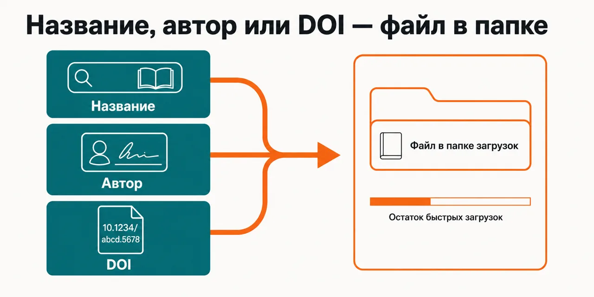
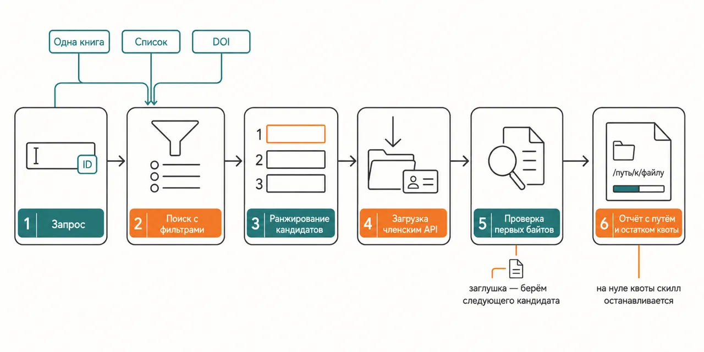

Русский · [English](README.en.md)

# Книга нужна прямо сейчас, а ты собираешь её по вкладкам: не тот формат, не тот язык, а скачанный файл открывается заглушкой

Ты называешь название, автора или DOI — скилл ищет запись в Архиве Анны, отбирает файл по политике
фильтров, качает членским API и печатает остаток быстрых загрузок.

```
claude plugin marketplace add https://gitlab.com/beCyborg/jadlis-hub.git
claude plugin install jadlis-books@jadlis
```

Ключ при установке не спрашивают: скачивание идёт членским API, и ключ кладёшь ты сам — в блок `env`
файла `~/.claude/settings.json`, после чего Claude Code перезапускается.



Текстом: слева запрос обычными словами или строкой DOI, справа — отобранный файл в папке загрузок и
строка с остатком быстрых загрузок.

Это моё рабочее место, выложенное как есть, а не продукт: чем перестал пользоваться — убрал.

## Было → стало

| Руками | Чатом с ИИ | Этим плагином |
|---|---|---|
| **С чем приходишь.** Название помнишь примерно, автора точно, а у статьи есть только DOI — и это три разных способа искать. | Разберёт фразу, но упрётся в то же место: дальше нужна страница, а не понимание запроса. | Название, автор и DOI разбираются на входе; DOI распознаётся по виду строки и уходит в свой маршрут. |
| **Какой файл берёшь.** Список выдачи оцениваешь на глаз: где скан, где заглушка, а где полный текст — не видно. | Даст ссылку на страницу, а файл не заберёт и в папку не положит. | Кандидаты ранжируются: совпадение названия и автора, обязательный флаг быстрой загрузки, больше зеркал-источников, новее год, не микроскопический размер. |
| **Когда нужного формата нет.** Качаешь что дали и разбираешься уже дома. | О наличии форматов не знает: он не открывал выдачу. | Формат идёт цепочкой EPUB → PDF → MOBI/AZW3 → FB2/DJVU в пределах английского; на английском нет ничего — показывает варианты на других языках и спрашивает. |
| **Список книг.** Каждую заново: поиск, выбор, загрузка, и так по кругу. | Список перепишет, скачает — нет. | Батч идёт циклом с паузами между книгами, отступления от политики помечаются в таблице, в конце — путь к каждому файлу. |
| **Сколько загрузок осталось.** Узнаёшь ровно в тот момент, когда упёрся. | Про квоту твоего аккаунта не знает вовсе. | Остаток быстрых загрузок приходит в ответе API и печатается в отчёте; на нуле скилл останавливается и отдаёт список недокачанного с md5. |

## Как это работает



На входе — название с автором, список названий или строка DOI.
Внутри — поиск с фильтрами формата, языка и типа издания, затем отбор кандидата: совпадение
названия и автора, обязательный флаг быстрой загрузки, больше зеркал, новее год.
На выходе — файл в папке, сверенный по первым байтам, и остаток быстрых загрузок в отчёте.

Текстом: запрос → поиск с фильтрами → ранжирование кандидатов → загрузка членским API → проверка
первых байтов файла → отчёт с путём и остатком квоты.

Различает скилл три вида запроса: одна книга, список книг и DOI. Одиночный запрос уходит строгим
поиском с фильтрами `--ext epub --lang en` и типом издания; ноль совпадений — фильтры снимаются, и
формат добирается клиентски по цепочке фоллбэка. Список обрабатывается той же дорогой по одной
странице выдачи на книгу, с паузой между книгами, и сводится в таблицу «книга / формат / язык / год
/ зеркала / фоллбэк / файл». Строка вида `10.xxxx/…` распознаётся сама: сначала точное попадание по
`/scidb`, при промахе — поиск по индексу журналов; если скачать не просили, скилл отдаёт только
таблицу кандидатов и ждёт подтверждения.

Кладётся файл в `~/Books/AnnasArchive` под именем вида `Автор — Название (Год)`, расширение берётся
из адреса загрузки; нужна другая папка — скажи об этом в запросе. Перед загрузкой скилл смотрит,
нет ли этого файла в папке назначения. После загрузки сверяются первые байты (EPUB → `PK`,
PDF → `%PDF`), слишком маленький файл удаляется как заглушка партнёрского сервера, и берётся
следующий кандидат. Зеркала перебираются сами по цепочке `.gl` → `.pk` → `.gd`, а ключ не печатается
в вывод и вычищается из текстов ошибок.

## Установка и первый запуск

**а) Текст для вставки агенту.** Скопируй целиком в чат Claude Code:

```
Ты — установщик. Поставь на этот Mac плагин jadlis-books из маркетплейса jadlis.
Выполни ровно эти команды, дословно, ничего не сокращая:
1. claude plugin marketplace add https://gitlab.com/beCyborg/jadlis-hub.git
2. claude plugin install jadlis-books@jadlis
3. claude plugin list — покажи мне строку про jadlis-books и его версию.
Ключей плагин при установке не спрашивает. После установки скажи мне одной строкой:
«Положи ключ Архива Анны в блок env файла ~/.claude/settings.json и перезапусти Claude Code».
Сам файл не правь и значение ключа не печатай: проверяй только «есть» или «нет».
Перед каждой командой покажи её мне целиком и дождись «да». Сказал «нет» — не выполняй,
скажи, что именно пропустил, и иди дальше.
Команда вернула ошибку — остановись, покажи вывод, к следующей не переходи.
```

**б) Команды руками.**

```
claude plugin marketplace add https://gitlab.com/beCyborg/jadlis-hub.git
claude plugin install jadlis-books@jadlis
claude plugin list
```

Первая команда ничего не ставит — она добавляет маркетплейс. Ставит только вторая, и снимается
она одной строкой: `claude plugin uninstall jadlis-books@jadlis --keep-data`.

Ключ сюда не передаётся: скрипты читают его из переменной окружения, а не из конфига плагина.
Положи его в блок `env` файла `~/.claude/settings.json` — файла ещё нет, значит это его содержимое
целиком; файл есть — добавь только пару `env`:

```json
{
  "env": {
    "ANNAS_ARCHIVE_KEY": "<твой-ключ>"
  }
}
```

Альтернатива — профиль шелла: `export ANNAS_ARCHIVE_KEY="<твой-ключ>"` в `~/.zshenv` (zsh) или
`~/.bashrc` (bash). После правки перезапусти Claude Code: переменные читаются при старте сессии.
Файл `settings.json` лежит открытым текстом — держи права на себе (`chmod 600`).

**в) Короткая команда.** Открой Claude Code в папке, где работаешь, и набери:

```
/books скачай The Mom Test в epub
```

Не находится — сверь имя строкой `claude plugin list`. Скилл поднимается и обычной фразой, без
слэша: «найди книгу …», «скачай эти книги: …», «скачай статью по DOI …». Ключа нет — скилл
остановится на первой же проверке и покажет, куда его положить; это ожидаемое поведение, а не
поломка.

Ещё примеры фраз:

- «скачай The Mom Test в epub»
- «найди книгу Обречены побеждать»
- «скачай эти книги: …» — список идёт одним батчем
- «скачай статью по DOI 10.1038/nature12373»

Полная форма команды — `/jadlis-books:books <запрос>`.

**Проверка после установки.** Запрос `скачай The Mom Test в epub` кладёт файл
`~/Books/AnnasArchive/Rob Fitzpatrick — The Mom Test (2013).epub`. В отчёте — формат, размер, год и
остаток быстрых загрузок.

## Что внутри и как выбирается файл

| Файл | Роль |
|---|---|
| `skills/books/SKILL.md` | инструкция: политика выбора, фоллбэки, обработка ошибок |
| `skills/books/references/gotchas.md` | ловушки из реальных загрузок: DNS, квота, DOI |
| `skills/books/scripts/aa_search.py` | поиск (парсинг HTML `/search`), режимы DOI и `--meta` |
| `skills/books/scripts/aa_download.py` | скачивание через `/dyn/api/fast_download.json`, проверка файла |

Оба скрипта — stdlib + `curl`, без зависимостей. HTTP идёт через `curl`, потому что WAF отдаёт 403 на
запросы из `urllib`.

Политика выбора файла:

1. Совпадение названия и автора.
2. Флаг быстрой загрузки (🚀) обязателен, иначе членский API файл не отдаст.
3. Формат: EPUB → PDF → MOBI/AZW3 → FB2/DJVU.
4. Язык: английский по умолчанию или тот, что ты попросил.
5. При равенстве: больше зеркал-источников → новее год → размер не микроскопический.

## Если что-то не так

| Симптом | Причина и что делать |
|---|---|
| `ERROR: ANNAS_ARCHIVE_KEY not set` | Сессия не видит ключ. Добавь его по инструкции выше и перезапусти Claude Code |
| `API error: Invalid secret key` | Ключ истёк или скопирован с обрезкой. Проверь членство и перевыпусти ключ |
| `API error` про quota | Дневная квота быстрых загрузок исчерпана. Скилл сохранит md5 недокачанного |
| `all mirrors failed` | Зеркала недоступны из твоей сети. Задай своё: `ANNAS_ARCHIVE_MIRROR=https://<домен>` в блок `env` (или профиль шелла) и перезапусти Claude Code |
| `ERROR: scripts not found` | Плагин установлен криво. Переустанови его командой из раздела «Обновление» ниже |
| `downloaded file suspiciously small` | Партнёрский сервер отдал заглушку. Скилл возьмёт следующего кандидата |

Ещё две оговорки:

- Повторное скачивание того же md5 может тратить квоту, поэтому скилл проверяет папку перед загрузкой.
- Поиск парсит HTML сайта: если сайт сменит вёрстку, `aa_search.py` придётся править.

## Границы, стоимость, обновление

**Чего не делает.** Не пересказывает книгу и не делает выжимку — приносит файл, читаешь его ты. Не
разбирает книжные форматы: внутрь EPUB, PDF или DJVU он не заглядывает и качество текста не
оценивает. Не распознаёт сканы и не чинит битые файлы: сверяет первые байты и на заглушке берёт
следующего кандидата. Не решает за тебя спорное — нет ничего на английском, показывает варианты и
спрашивает; DOI без просьбы скачать отдаёт таблицей кандидатов. **Не приносит файл по DOI:** по нему
он ищет и находит запись, но маршрут загрузки идёт через членский API по контрольной сумме, и для
научной статьи он обрывается — файл берётся открытым доступом, обычной загрузкой мимо плагина, и
это делаешь ты. Не ходит в залогиненные места: скрипты стучатся только в зеркала Архива Анны и по
выданному адресу загрузки.

**Что нужно.** Активное членство Архива Анны и его API-ключ со страницы аккаунта: быстрые загрузки
идут членским API, и без ключа скилл останавливается на первом шаге. Ключ в диалог установки не
попадает — он живёт в переменной окружения `ANNAS_ARCHIVE_KEY` (`env` в `~/.claude/settings.json`
либо `export` в профиле шелла). Из внешнего нужны только `python3` и `curl` в PATH: скрипты на
стандартной библиотеке, зависимостей не тянут. Зеркало можно задать своё — `ANNAS_ARCHIVE_MIRROR`,
туда же, в `env`. Чужие тарифы не пересказываю: счёт за членство у поставщика.

[уточнить] — аккаунт без активного членства я не проверял: поиск ключа не требует, загрузка требует.

[уточнить] — локальный DNS у некоторых провайдеров не резолвит хосты партнёрских серверов загрузки;
проверено на моей сети, обход — публичный DNS.

**Порядок расхода токенов.** Прогон лёгкий: поиск, отбор кандидата и загрузка — это вызовы скриптов,
субагенты сюда не поднимаются. Дороже прочего обходится батч: на каждую книгу своя страница выдачи,
свой разбор кандидатов и своя строка отчёта. Тратится при этом не только твоя квота модели, но и
квота быстрых загрузок аккаунта — её остаток печатается в отчёте, а на нуле скилл останавливается
сам.

**Проверено там, где я работаю:** мой Mac, моё членство, мой ключ. Где ещё это работает —
[уточнить].

**Условия использования.** Лицензии нет: все права сохранены за автором. Читать и
пользоваться лично можно. Коммерческое использование, переиздание и включение в свои
продукты — по договорённости со мной.

**Обновление.** У стороннего маркетплейса авто-обновление на твоей стороне выключено: пока не
запустишь первую команду, у тебя остаётся та версия, которую ты поставил.

```
claude plugin marketplace update jadlis
claude plugin update jadlis-books@jadlis
claude plugin list
```

Переустановка, если что-то встало криво:

```
claude plugin uninstall jadlis-books@jadlis --keep-data && claude plugin install jadlis-books@jadlis
```

**Переход с версии 2.x.** С версии 3.0.0 репозиторий живёт на GitLab, а плагин лежит в корне
репозитория. Если плагин стоял из старого каталога jadlis-books (маркетплейс `becyborg-library`),
обновление не приедет само. Удали старую установку и поставь плагин из хаба jadlis:

```
claude plugin uninstall jadlis-books@becyborg-library --keep-data
claude plugin marketplace remove becyborg-library
claude plugin marketplace add https://gitlab.com/beCyborg/jadlis-hub.git
claude plugin install jadlis-books@jadlis
```

Если маркетплейс `jadlis` у тебя ещё смотрит на старый адрес на GitHub, сначала убери его:
`claude plugin marketplace remove jadlis`. Потом выполни две последние команды из блока выше.
